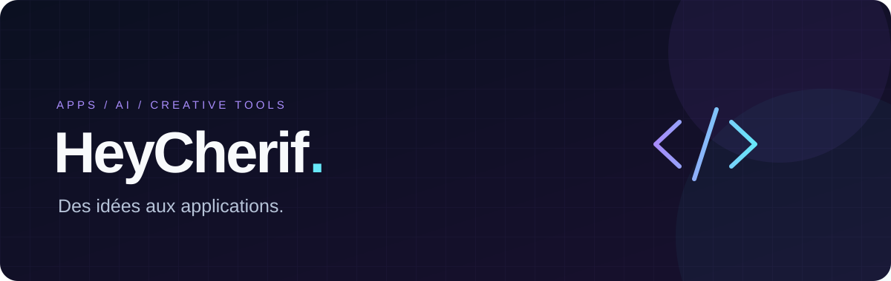

### Des idées aux applications.

**Applications desktop · Intelligence artificielle · Outils créatifs**

Je crée des outils pour jouer, traduire et donner vie aux histoires.

---

### Ce que je construis

<table>
<tr>
<td width="50%" valign="top">

#### 🎮 Nexus Launcher
Une bibliothèque visuelle pour retrouver et lancer ses jeux PC. Navigation clavier et manette, jaquettes et suivi des sessions.

**Desktop · React · Gaming**

[Explorer le projet →](https://github.com/HeyCherif/Nexus-Launcher)

</td>
<td width="50%" valign="top">

#### 📖 Renkavi
Un atelier pour traduire des documents et des récits illustrés : OCR, correction des textes et export.

**Python · OCR · Traduction**

[Explorer le projet →](https://github.com/HeyCherif/Renkavi)

</td>
</tr>
<tr>
<td width="50%" valign="top">

#### 🎙️ DubRoom Studio
Un studio local en développement pour préparer la transcription, la traduction et le doublage de vidéos.

**Electron · TypeScript · FastAPI**

[Explorer le projet →](https://github.com/HeyCherif/dubroom-studio)

</td>
<td width="50%" valign="top">

#### 🧭 FindMyFiliere
Une application web pour rechercher une filière et découvrir des parcours adaptés à son profil.

**Laravel · PHP · Tailwind CSS**

[Explorer le projet →](https://github.com/HeyCherif/findmyfiliere)

</td>
</tr>
</table>

### Mes terrains d’exploration

- **Des applications utiles** : transformer un besoin concret en outil simple à utiliser.
- **L’IA et les récits illustrés** : OCR, traduction, voix et outils de création.
- **L’expérience desktop** : des interfaces visuelles pensées pour un usage quotidien.

---

**Imaginer. Construire. Améliorer.**

